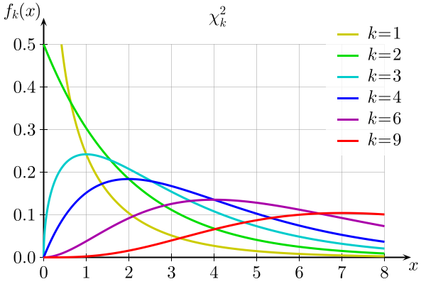
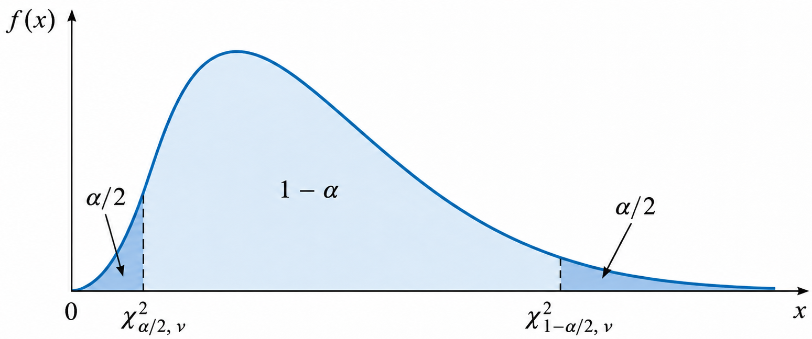

## Parte 1: Intervalo de Confiança para a Variância ($\sigma^2$)

Para construir um IC para a variância populacional, assumimos que a população original é **Normal**.

- **A Quantidade Pivotal:** Utilizamos a relação entre a variância amostral ($S^2$) e a populacional ($\sigma^2$):

$$Q = \frac{(n-1)S^2}{\sigma^2} \sim \chi^2_{n-1}$$

- Essa quantidade segue uma distribuição **Qui-quadrado** com $n-1$ graus de liberdade.


## Distribuição Qui-quadrado ($\chi^2$)

1.  **Não é simétrica:** Ela é "torta" para a direita.
2.  **Só assume valores positivos:** Variância nunca é negativa.
3.  **Consequência para o IC:** Os valores críticos da tabela não são iguais ($\pm z$). Precisamos olhar dois valores distintos: $\chi^2_{\text{inf}}$ e $\chi^2_{\text{sup}}$.

<div style="text-align: center;">
  
  
</div>


## Construção do IC para $\sigma^2$

Partimos da probabilidade:
$$P(\chi^2_{\alpha/2} \le \frac{(n-1)S^2}{\sigma^2} \le \chi^2_{1-\alpha/2}) = 1-\alpha$$

Ao isolar $\sigma^2$ (invertendo as frações), obtemos:

$$IC(\sigma^2; 1-\alpha) = \left[ \frac{(n-1)S^2}{\chi^2_{1-\alpha/2;n-1}} \; ; \; \frac{(n-1)S^2}{\chi^2_{\alpha/2;n-1}} \right]$$

- Note que o valor *maior* da tabela fica no denominador do limite *inferior*, e vice-versa.


## Fragilidade do IC para $\sigma^2$

O método da Qui-quadrado **não é robusto**. Isso significa que ele é muito sensível à suposição de normalidade.

- Diferente da média (onde o TCL ajuda em grandes amostras), para a variância, a **curtose** (peso das caudas) distorce gravemente a cobertura do intervalo.
- **Se os dados não forem normais:**
    1.  O nível de confiança real pode ser muito menor que 95% (o intervalo fica "mentiroso").
    2.  **Solução:** Utilizamos métodos computacionais de reamostragem, como o **Bootstrap**.

> **Regra de Ouro:** Só use a fórmula da $\chi^2$ se o teste de normalidade (ex.: Shapiro-Wilk) e o QQ-Plot confirmarem que os dados são normais.


## Exemplo 16.1

Um analista de risco monitorou o retorno diário de uma ação por 20 dias e encontrou uma variância amostral igual a 0,04. Construa um IC de 95% para a variância real $\sigma^2$.


## Exemplo 16.2

Uma farmacêutica precisa garantir que a variabilidade na dosagem de um comprimido seja mínima. Uma amostra de 15 comprimidos revelou uma variância amostral de 4 $\text{mg}^2$. Supondo que a dosagem segue uma distribuição Normal, construa um IC de 95% para a variância populacional ($\sigma^2$).


## Parte 2: Intervalo para a Proporção ($p$)

- Agora mudamos o foco de variáveis contínuas (dinheiro, tempo) para variáveis binárias (Sucesso/Fracasso).

- **Estimador Pontual:** $\widehat{p} = \frac{X}{n}$ (número de sucessos / total).
- A distribuição exata é a Binomial, que é complexa para calcular intervalos.
- Usamos como solução para grandes amostras o Teorema Central do Limite (TCL).


## Justificativa Assintótica

- Para $n$ suficientemente grande, a distribuição de $\widehat{p}$ se aproxima de uma Normal:

$$\widehat{p} \approx N\left(p, \frac{p(1-p)}{n}\right)$$

- A quantidade pivotal aproximada é:  $~Z = \frac{\widehat{p} - p}{\sqrt{\frac{\widehat{p}(1-\widehat{p})}{n}}} \sim N(0,1)$

- Isolando $p$, chegamos ao **Intervalo de Wald**:
$$IC(p) = \widehat{p} \pm z_{\alpha/2} \sqrt{\frac{\widehat{p}(1-\widehat{p})}{n}}$$


## Validade do IC para $p$

- O Método de Wald é uma **aproximação**. Para usá-lo, devemos garantir que a normalidade "pegou".

- **Regra Prática:** o intervalo é confiável se o número esperado de sucessos e fracassos for pelo menos 5 (alguns autores usam 10):

    - $n \cdot \widehat{p} \ge 5$
    - $n \cdot (1-\widehat{p}) \ge 5$

> **Caso contrário:** Devemos usar métodos "Exatos" (como Clopper-Pearson), que o R calcula automaticamente se pedirmos.


## Exemplo 16.3

Em uma pesquisa com 400 consumidores, 160 afirmaram preferir a marca A. Construa um IC de 95% para a proporção real de preferência.


## Exemplo 16.4

Uma seguradora deseja estimar a taxa de renovação de sua carteira de automóveis para projetar o fluxo de caixa do próximo ano. Em uma amostra aleatória de 500 apólices que venceram no mês passado, 425 foram renovadas. Construa um IC de 90% para a verdadeira proporção de renovação ($p$).


## Aplicação no R: `VarCI`

- Para a variância, utilizamos a função `VarCI` do pacote `DescTools`.
- Você precisa instalar o pacote `DescTools` apenas uma vez usando o comando `install.packages("DescTools")`

```{r}
#| echo: true
#| eval: true

# Dados do Exemplo 16.2
# Supondo que temos os dados coletados
dosagem <- c(53.6, 51.0, 46.1, 51.4, 49.1, 47.9, 49.6, 47.9, 48.5, 48.7,
             46.6, 51.7, 50.3, 47.7, 52.5)

# Cálculo do IC para a Variância
DescTools::VarCI(dosagem, conf.level = 0.95, method = "classic")

```

- Se você quiser o IC para o desvio padrão, basta acrescentar o argumento `sd = TRUE` dentro da mesma função (ou tirar a raiz quadrada dos limites manualmente):
`DescTools::VarCI(dosagem, conf.level = 0.95, method = "classic", sd = TRUE)`
- Se os dado não forem normais, use `method = "boot"`


## Aplicação no R: `BinomCI`

- Para proporções, o pacote `DescTools` oferece a função `BinomCI`.

```{r}
#| echo: true
#| eval: true

# x = sucessos, n = total
# method = "wald" (para grandes amostras)
DescTools::BinomCI(x = 160, n = 400, conf.level = 0.95, method = "wald")

```

- Se a amostra for pequena, use `method = "clopper-pearson"`


## Resumo

| Parâmetro | Cenário | O que usar | Ação / Fórmula |
| :--- | :--- | :--- | :--- |
| $\sigma^2$ | População **Normal** | **Qui-quadrado<br> ($\chi^2$)** | $\left[ \frac{(n-1)S^2}{\chi^2_{\text{sup}}} ; \frac{(n-1)S^2}{\chi^2_{\text{inf}}} \right]$ |
| $\sigma^2$ | População **Não-Normal** | **Bootstrap** (Reamostragem) | Usar métodos computacionais. |
| $p$ | Grandes Amostras<br>($n\widehat{p} \ge 5$) | **Normal ($Z$)** [Wald] | $\widehat{p} \pm z \sqrt{\frac{\widehat{p}(1-\widehat{p})}{n}}$ |
| $p$ | Pequenas Amostras | **Exato** [Clopper-Pearson] | Usar função do R. |


# Fim