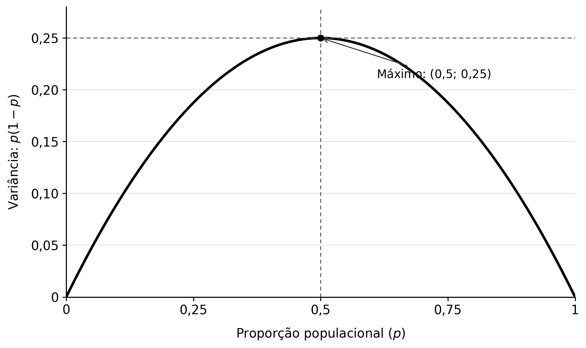

## Introdução

- O cálculo do tamanho da amostra é a resposta para a pergunta: *"Quantos dados eu preciso coletar para garantir que meu erro não ultrapasse um limite pré-estabelecido?"*
- Esse cálculo envolve:
    - **Custo ($n$):** Tempo e dinheiro.
    - **Confiança ($1-\alpha$):** Certeza no método.
    - **Precisão ($E$):** Margem de erro aceitável.

> Não podemos ter precisão infinita com orçamento finito. Definir o tamanho da amostra é a arte de equilibrar essa equação.

## Erro Máximo ($E$)

- Um intervalo de confiança simétrico é dado por: $$\text{Estimativa} \pm \text{Margem de Erro}.$$

- Toda fórmula para determinar $n$ deriva da Margem de Erro ($E$) do Intervalo de Confiança.

- O que fazemos e fixar o Erro e isolar $n$.

## Tamanho de Amostra para a Média Populacional ($\mu$)

- Para uma população infinita ou muito grande, o IC é dado por
$$IC = \overline{X} \pm E \quad \text{onde} \quad E = Z_{\alpha/2} \frac{\sigma}{\sqrt{n}}.$$

- Isolando $n$, temos: $$n = \left( \frac{z_{\alpha/2} \cdot \sigma}{E} \right)^2$$

## Tamanho de Amostra para a Média Populacional ($\mu$)

- Então, para determinarmos o tamanho de amostra para estimar a média populacional $\mu$ precisamos de:
  - **Nível de Confiança ($1-\alpha$):** Determina o valor de $z_{\alpha/2}$ (ex: 1,96 para 95%).
  - **Erro Máximo Tolerado ($E$):** O quanto aceitamos errar para mais ou para menos (na mesma unidade dos dados).
  - **Variabilidade da População ($\sigma$):** Este é o maior desafio. Se não conhecemos $\sigma$, usamos:
      - Um desvio padrão de um estudo piloto.
      - Dados da literatura ou histórico.
      - Uma estimativa grosseira: $\sigma \approx \frac{\text{Amplitude}}{4}$.

## Impacto da Variância ($\sigma^2$)

- Observe que na fórmula $n$ é diretamente proporcional a $\sigma^2$.

  - Ou seja, a necessidade de dados cresce com o **quadrado** da variabilidade.

  - Isto é, se a variância do fenômeno dobra, precisamos do dobro de dados. Se o desvio padrão dobra, precisamos de *quatro vezes* mais dados.

> **Implicação Atuarial:** Carteiras de seguros com alta volatilidade (caudas pesadas) exigem bancos de dados muito grandes para que a estimativa da média seja confiável. Fenômenos estáveis exigem poucos dados.

## Exemplo 17.1

Um auditor precisa estimar o valor médio das notas fiscais emitidas por uma empresa com erro máximo de R\$ 5,00 e 95\% de confiança. Um estudo piloto indicou um desvio padrão de R\$ 50,00. Qual deve ser o tamanho de amostra que ele deve usar para estimar a média?

## Exemplo 17.2

Uma fábrica de cabos de aço quer estimar a resistência média à ruptura. Sabe-se que $\sigma = 300$ kgf. O engenheiro aceita um erro de 20 kgf, mas exige uma confiança altíssima de 99%. Qual deve ser o tamanho de amostra para estimar essa média?

> Reflexão: Testes destrutivos são caros. Será que vale a pena subir de 95% para 99% e gastar muito mais material? Essa é a decisão gerencial.

## Tamanho de Amostra para a Proporção ($p$)

- Partindo do Erro de Wald: $E = Z_{\alpha/2} \sqrt{\frac{p(1-p)}{n}}$.
- Isolando $n$:

$$n = \frac{Z_{\alpha/2}^2 \cdot p(1-p)}{E^2}$$

- **Dilema Circular:** para calcular $n$, precisamos de $p$. Mas $p$ é justamente o que queremos estimar com a pesquisa!

## Solucionando o Dilema da Proporção

Temos dois caminhos para definir o valor de $p$ na fórmula:

**Cenário A: Informação Prévia**

- Temos uma pesquisa antiga ou estudo similar (ex.: que indicou $p \approx 0{,}20$).
- Usamos esse valor na fórmula.

::::{columns}

:::{.column width="75%"}
**Cenário B: Sem Informação (Estimativa Conservadora)**

- Não sabemos nada sobre $p$.
- Assumimos o **pior cenário** de variância.
- A variância $p(1-p)$ é máxima quando **$p = 0{,}5$** ($0{,}5 \times 0{,}5 = 0{,}25$).
:::

:::{.column width="25%"}

{width="150%"}

:::

::::

## Estimativa Conservadora ($p=0{,}5$)

Ao usar $p=0{,}5$, garantimos o tamanho de amostra máximo necessário.

$$n_{\text{cons}} = \frac{Z_{\alpha/2}^2 \cdot 0,25}{E^2}\quad\text{ou}\quad n_{\text{cons}}=\frac{Z_{\alpha/2}^2}{4 \,E^2}$$

- **Vantagem:** Garante a precisão desejada independente do valor real de $p$.
- **Desvantagem:** Pode superestimar o tamanho da amostra (custo maior), especialmente se o $p$ real for extremo (perto de 0 ou 1).

## Exemplo 17.3

Um instituto vai realizar uma pesquisa em uma cidade onde não há histórico de intenção de votos. Deseja-se uma margem de erro de 3% (0,03) com 95% de confiança. Qual deve ser o número de eleitores entrevistados?

## Exemplo 17.4

Uma fábrica de peças automotivas quer estimar a proporção de peças defeituosas. O histórico mostra que a taxa de defeitos nunca passou de 10% ($p \approx 0,10$). Qual deve ser o tamanho de amostra para se ter um erro máximo de 2% com 95% de confiança?

## Relações de Trade-off

| Parâmetro | Ação | Efeito em $n$ | Natureza |
| :--- | :--- | :--- | :--- |
| **Erro ($E$)** | Reduzir (mais precisão) | **Aumenta** ($\uparrow \uparrow$) | Quadrática (inversa) |
| **Confiança** | Aumentar (95% $\to$ 99%) | **Aumenta** ($\uparrow$) | Não-linear |
| **Variância** | Aumentar (mais ruído) | **Aumenta** ($\uparrow$) | Linear (com $\sigma^2$) |

> **Regra de Bolso:** Para reduzir o erro pela metade, você precisa **quadruplicar** o tamanho da amostra.

## Consideração: População Finita ($N$)

- Tudo o que vimos assume população infinita (ou muito grande).
- Se a população for pequena (ex: $N < 10.000$), aplicamos a Correção de População Finita:
$$n_{\text{final}} = \frac{n}{1 + \frac{n - 1}{N}}$$

- Isso reduz o tamanho da amostra necessário, pois a população se "esgota" conforme amostramos.
- **Regra de bolso:** Essa fórmula deve ser usada quando $n/N > 0{,}05$ (ou seja, se a amostra representa mais de 5% da população).

# Fim