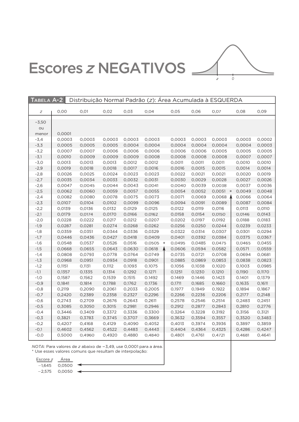
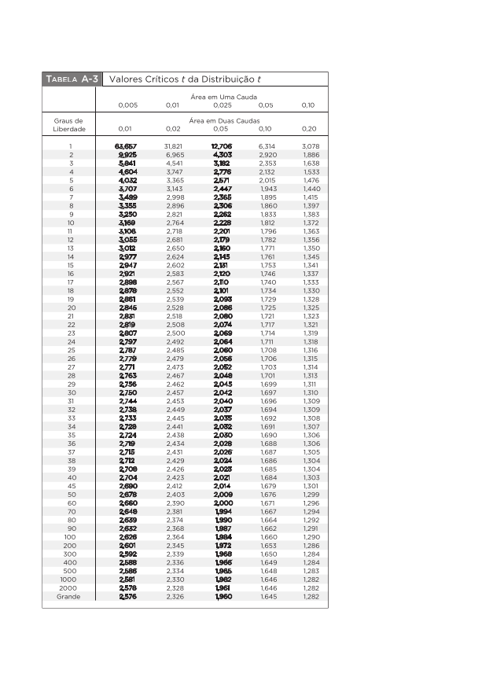
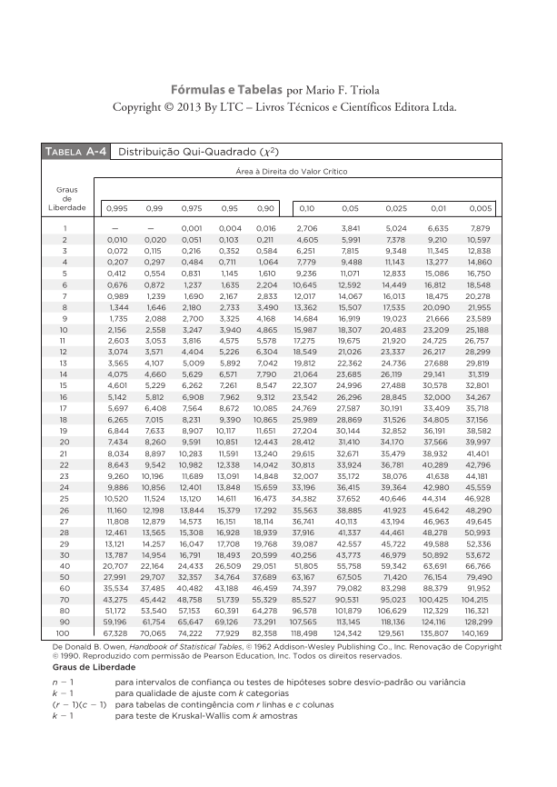

Acesse aqui as tabelas estatísticas mais importantes para o nosso curso de Inferência. Elas serão ferramentas essenciais para a resolução de exercícios e para as avaliações da disciplina.

::: {.grid}

::: {.g-col-12 .g-col-md-4}

Tabela Normal

:::

::: {.g-col-12 .g-col-md-4}

Tabela t

:::

::: {.g-col-12 .g-col-md-4}

Tabela Qui-quadrado

:::

:::

